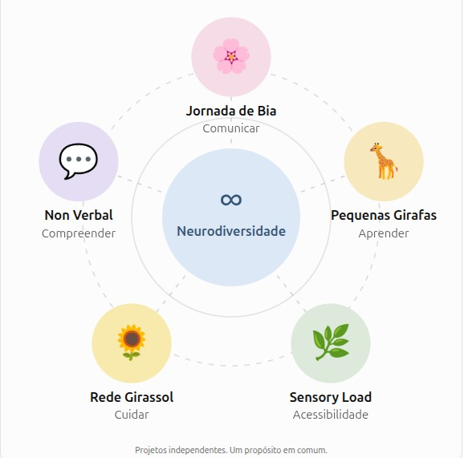

# Rafael Ricardo Mayer

### Inteligência Artificial | Desenvolvimento de Software | Tecnologia Assistiva | Neurodiversidade

Sou **Rafael Ricardo Mayer**, desenvolvedor de software, pesquisador independente e autor. Trabalho com inteligência artificial aplicada, acessibilidade digital e tecnologia assistiva.

Desenvolvo aplicativos e APIs que apoiam a comunicação e a autonomia de pessoas neurodivergentes, especialmente pessoas autistas.

📍 Curitiba, Paraná, Brasil

🌐 **[Meu portfólio e projetos](https://rafaelrmayer.github.io/)**

---

## Projetos independentes, um propósito comum

Comunicação, aprendizagem, acessibilidade e acesso à informação. Ilustração criada com auxílio de IA; cada projeto tem seu próprio estágio de desenvolvimento.

## 🚀 Projetos em destaque

### 🌸 A Jornada de Bia

**Tecnologia Assistiva | Comunicação Alternativa e Aumentativa | Inteligência Artificial**

Aplicativo de comunicação assistiva voltado a pessoas autistas não falantes e pessoas com necessidades complexas de comunicação.

O aplicativo permite montar frases com cartões visuais, ouvir as frases com síntese de voz, personalizar cartões e organizar rotinas e atividades.

> Não é sobre ensinar alguém a falar. É sobre garantir que sua voz possa ser ouvida.

🔗 [Ver repositório da Jornada de Bia](https://github.com/rafaelrmayer/jornada-de-Bia_Sakura_V_9.1) · [Experimentar o aplicativo](https://rafaelrmayer.github.io/jornada-de-Bia_Sakura_V_9.1/)

### 🦒 Pequenas Girafas

**Alfabetização inclusiva | Python · FastAPI | JavaScript | Processamento local**

Ao lado da Jornada de Bia, que apoia a comunicação, Pequenas Girafas explora letras e palavras com imagens, áudio em português brasileiro e letras móveis. A demonstração permite associar imagem e palavra, completar uma letra e montar palavras por clique ou arraste.

As sugestões de atividades usam regras e um grafo semântico local. O progresso fica no dispositivo, sem envio do histórico de aprendizagem ao servidor. As atividades podem ser escolhidas livremente; não há modelo treinado de aprendizagem nesta versão.

**Demonstração experimental, sem validação pedagógica.** Código disponível para reutilização não comercial sob PolyForm Noncommercial 1.0.0, preservando os termos e os avisos de autoria. Componentes de terceiros mantêm condições próprias.

🔗 [Experimentar Pequenas Girafas](https://pequenas-girafas.onrender.com/) · [Ver repositório e licença](https://github.com/rafaelrmayer/pequenas-girafas)

### 🧠 Neural API

**Python | PyTorch | FastAPI**

A API explora como redes neurais podem ordenar sugestões de cartões de comunicação a partir do contexto. Na demonstração, você pode mudar o período do dia e a última atividade escolhida para ver como a ordem dos cartões muda. O modelo foi treinado com dados sintéticos e roda no navegador.

🔗 [Experimentar a demonstração](https://rafaelrmayer.github.io/#neural-api) · [Ver repositório](https://github.com/rafaelrmayer/neural-api)

### 🌿 Sensory Load API

**Python | FastAPI | Análise de Dados | Acessibilidade**

API experimental para estimar a carga sensorial de ambientes, considerando ruído, iluminação, densidade de pessoas, imprevisibilidade e dificuldade de recuperação sensorial.

Na demonstração web, você pode escolher um ambiente e um horário, consultar os cinco fatores e acompanhar como a carga sensorial varia ao longo do dia. A interface usa dados fictícios.

Os dados e parâmetros atuais são demonstrativos e ainda não foram validados cientificamente.

🔗 [Conhecer a Sensory Load API e sua demonstração](https://github.com/rafaelrmayer/sensory-load-api)

### 🌻 Rede Girassol API

**TypeScript | Cloudflare Workers | Dados de Saúde**

API para organização e consulta de informações sobre estabelecimentos e serviços de saúde.

O projeto prevê integração com fontes oficiais, incluindo CNES e ANS, respeitando a procedência e os limites dos dados.

🔗 [Conhecer a Rede Girassol API](https://github.com/rafaelrmayer/Rede_Girassol_API_V_1)

### 🖋️ INK Bia Cerisier

**Backend | APIs REST | SaaS**

Projeto de plataforma para gestão de estúdios de tatuagem e profissionais independentes, com foco na organização de clientes, atendimentos e processos.

🔗 [Conhecer o INK Bia Cerisier](https://github.com/rafaelrmayer/ink-bia-cerisier)

### 💙 Prospecta

**Desenvolvimento Web | Prospecção Comercial | SaaS**

Protótipo de plataforma para pesquisa, organização e qualificação de oportunidades comerciais, inicialmente com dados demonstrativos.

🔗 [Conhecer o Prospecta](https://github.com/rafaelrmayer/Prospecta_V1)

### 🔭 Explorador do Universo

**Astronomia | Educação Científica | Tecnologia Educacional**

Conceito de aplicação educacional voltada à exploração de astronomia e fenômenos científicos por meio de experiências interativas.

🔗 [Conhecer o Explorador do Universo](https://github.com/rafaelrmayer/explorador-do-universo-v1)

---

## 📚 Livros e publicações

Além do desenvolvimento de software, dedico-me à pesquisa e à produção escrita, explorando as relações entre inteligência artificial, acessibilidade, comunicação e inclusão.

### 📖 Redes Neurais Artificiais e Comunicação Personalizada

**Redes Neurais Artificiais e Comunicação Personalizada: Uma Proposta de Arquitetura Adaptativa para Inclusão de Pessoas Autistas com Necessidades Complexas de Comunicação**

**Autor:** Rafael Ricardo Mayer  
**Formato:** eBook Kindle  
**Disponibilidade:** Amazon Brasil

A obra investiga possibilidades de utilização de redes neurais artificiais e arquiteturas adaptativas para apoiar a comunicação personalizada de pessoas autistas com necessidades complexas de comunicação.

A publicação está relacionada aos meus interesses em inteligência artificial aplicada, Comunicação Alternativa e Aumentativa (CAA), acessibilidade e tecnologia assistiva.

📖 **[Conheça o livro na Amazon](https://www.amazon.com.br/dp/B0HMPHYPT6)**

### 📖 Cosmos Algorítmico

Publicação de Rafael Ricardo Mayer sobre inteligência artificial e astronomia.

📖 **[Conheça Cosmos Algorítmico na Amazon](https://www.amazon.com.br/dp/B0HRRX3TMY)**

---

## 🔬 Pesquisa e áreas de interesse

- Inteligência Artificial e Machine Learning
- Redes neurais artificiais e modelos adaptativos
- Desenvolvimento de tecnologias para pessoas neurodivergentes, especialmente autistas
- Comunicação Alternativa e Aumentativa (CAA)
- Acessibilidade digital e tecnologias assistivas
- Educação inclusiva e aprendizagem personalizada
- Desenvolvimento de APIs e arquitetura de software
- Análise de dados e aprendizado de padrões
- Privacidade, proteção de dados e IA responsável

---

## 🛠️ Tecnologias e ferramentas

**Linguagens:** Python, JavaScript, TypeScript, HTML e CSS.

**Backend e APIs:** FastAPI, Flask, REST APIs e Cloudflare Workers.

**Dados e ferramentas:** SQLite, SQL, Git, GitHub, GitHub Codespaces e testes automatizados.

**Pesquisa aplicada:** Random Forest, aprendizado de máquina, redes neurais artificiais e arquiteturas de personalização.

---

## 🌱 Tecnologia com propósito

> Não quero apenas deixar um legado de tecnologia para minha filha. Quero ajudar a construir o mundo em que ela vai viver e contribuir para que esse mundo também seja melhor para outras pessoas.

Esse propósito conecta meus projetos e orienta minha forma de pesquisar, desenvolver e aprender.

Acredito em uma tecnologia centrada nas pessoas, construída com responsabilidade, acessibilidade, respeito às diferenças e compromisso com a autonomia de quem a utiliza.

---

## 📬 Contato e redes sociais

Estou aberto a conversas, trocas de conhecimento e colaborações relacionadas a inteligência artificial, desenvolvimento de software, pesquisa, acessibilidade, neurodiversidade e tecnologia assistiva.

- 💼 **LinkedIn:** [Rafael Ricardo Mayer](https://www.linkedin.com/in/rafael-ricardo-mayer-478647a4/)
- 💻 **GitHub:** [github.com/rafaelrmayer](https://github.com/rafaelrmayer)
- 📸 **Instagram:** [@rafael_rmayer](https://www.instagram.com/rafael_rmayer/)
- 📚 **Livro na Amazon:** [Redes Neurais Artificiais e Comunicação Personalizada](https://www.amazon.com.br/dp/B0HMPHYPT6)
- 📚 **Livro na Amazon:** [Cosmos Algorítmico](https://www.amazon.com.br/dp/B0HRRX3TMY)

---

**Desenvolvido por Rafael Ricardo Mayer**

*Tecnologia com propósito. Inteligência a serviço das pessoas.*

**Sempre rumo à utopia e ao horizonte. ♾️**
